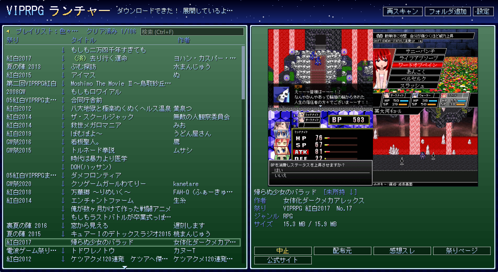

# RPG Launcher

A Windows and Linux launcher for RPG Maker, Wolf RPG Editor, Ren'Py, TyranoBuilder and Unity games that shows title screens as cards and fills in titles, tags and images from DLsite. 

This program has two modes: VIPRPG mode and HRPG mode, because in 2026 it's easier to fuse two programs into one than it is to make two separate but similar programs.

VIPRPG mode is linked to a Cloudflare server containing all the VIPRPGs I could find and download. It allows one to download and organize VIPRPGs quite easily with various features like grouping, playlist making, and so on. They are stored naturally as  Playlists can be shared. 



HRPG mode is built around organizing DLsite games and checking new releases on the site more easily. The main feature of convenience is built-in network adapter + proxy settings to more easily check DLsite's page through a Japanese VPN without needing to constantly turn the VPN on or off.


## Quick start

1. Download the launcher from the releases.
2. Run it. The first time, it asks what you're using it for (DLsite HRPGs or VIPRPGs) and opens in that mode. You can then go to options and select folders of pre-existing games to add. It scans those folders up to three levels deep. VIPRPGs downloaded will go into the directory the executable is in.
3. Click a game to play. Press `F5` to refresh the page after adding new games.

## Features

- **Sort** by title, folder, rating, last or most played, release date or download date.
- **Filter** by engine, group, favorites, tags, or games without a DLsite page. **Search** covers titles, folder names, circles and tags in English and Japanese.
- **Ratings, favorites, play count and play time.**
- **Groups** — right-click a card → **Groups**. Groups appear in the sort menu; drag them there to reorder.
- **Tags** — click a tag once to show only games with it, twice to hide them, a third time to clear it. Right-click a tag to pin it. Right-click a card → **Add Tags…** for your own tags.
- **Names and pictures** — cards use the DLsite title and image, or the game's cleaned title and title screen. Right-click a card to rename it, change or reframe its picture, or choose title screen or DLsite image.
- **New on DLsite** — games released in the last 30 days, with price, discount, rating and tags.
- **Display** — four styles, rectangular or square cards, optional paging, English or Japanese metadata. On screens of 2560×1440 or more the window opens at 1920×1080.
- **Cheats** — right-click an MV or MZ game → **Play with Cheats** to change gold, levels, EXP, HP, MP and stats while playing, heal the party, walk faster or walk through walls. **Advanced…** edits variables, switches and items, runs and replays events, opens the save and load screens anywhere, and has a script console. Other RPG Maker games get **Play in Test Mode**. 

## Linux

- The launcher is a native Linux program. Unpack the `.tar.gz` (it keeps the file executable) and run `RPG Launcher`; it needs X11 or XWayland and the ICU library (`libicu`), which desktop distributions include.
- Windows games start through Wine (`wine` on the path). Ren'Py games that include a Linux build start natively with their own `Name.sh` (when that build is marked executable), as do Linux builds of Unity games. **⋯ → Wine command…** sets another, such as `flatpak run org.winehq.Wine`. Games get a Japanese locale (`LANG=ja_JP.UTF-8`) so their text shows; `env LANG=… wine` overrides it.
- Cheats and test mode work the same through Wine.
- Proxy settings are encrypted with a key only your user can read, in `~/.config/rpg-launcher`.
- Sending DLsite requests through a network adapter needs Linux 5.7 or newer.


## Building

Requires the [.NET 8 SDK](https://dotnet.microsoft.com/download/dotnet/8.0). The interface uses [Avalonia](https://avaloniaui.net/).

```powershell
.\build.ps1                       # Windows: self-contained single-file exe
.\build.ps1 -Runtime linux-x64    # Linux: single file in LauncherSource\bin\publish\linux-x64
.\build.ps1 -FrameworkDependent   # smaller; needs the .NET 8 runtime
.\build.ps1 -NoCompression        # larger, faster startup
```

Without PowerShell: `dotnet publish LauncherSource/RPGLauncher.csproj -c Release -r linux-x64 --self-contained -p:PublishSingleFile=true -p:IncludeNativeLibrariesForSelfExtract=true`.

## Troubleshooting

- **SmartScreen warning** — the exe is unsigned: **More info → Run anyway**.
- **Game missing** — check the engine table and folder depth, then press `F5`.
- **No metadata** — sort menu → **No DLsite Page** lists these games; use **Set DLsite page…**.
- **Linux: a game doesn't start** — check that `wine` runs it from a terminal, or set **⋯ → Wine command…**.
- **Crash** — see `%TEMP%\rpglauncher.log` (Linux: `/tmp/rpglauncher.log`).
