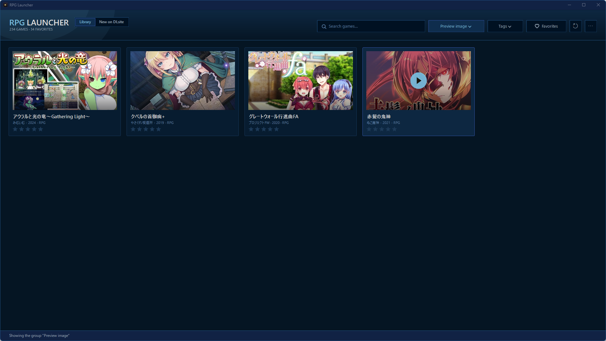

# RPG Launcher

A Windows launcher for RPG Maker and Wolf RPG Editor games that shows title screens as cards and fills in titles, tags and images from DLsite. 

...Or to be more honest, this is basically an HRPG launcher built around organizing DLsite games and checking new releases on the site more easily. The main feature of convenience is built-in network adapter + proxy settings to more easily check DLsite's page through a Japanese VPN without needing to constantly turn the VPN on or off. This launcher was completely vibecoded and while it works for me I really have no idea how any of the network stuff works, so go in with due caution and all that.



## Quick start

1. Download the launcher from the releases and put it in the holder with your games (or anywhere).
2. Run it. It scans that folder up to three levels deep. You can add other folders by going to the options menu (the ... menu) and choosing "Add Directory."
3. Click a game to play. Press `F5` to refresh the page after adding new games.

## Supported engines

| Engine | Detected by |
| --- | --- |
| RPG Maker MV / MZ | `www\data\System.json` or `data\System.json` |
| RPG Maker VX Ace / VX / XP | `Game.ini` with `Data\` or a `.rgss3a` / `.rgss2a` / `.rgssad` archive |
| RPG Maker 2000 / 2003 | `RPG_RT.exe` / `RPG_RT.ldb` |
| Wolf RPG Editor | `Game.exe` with `Data.wolf`, `Data\*.wolf`, `Data\BasicData` or `GuruguruSMF4.dll` |

Encrypted MV/MZ images and RGSS archives are read directly. Wolf games use the folder name as title until DLsite supplies one.

## Features

- **Sort** by title, folder, rating, last or most played, release date or download date.
- **Filter** by engine, group, favorites, tags, or games without a DLsite page. **Search** covers titles, folder names, circles and tags in English and Japanese.
- **Ratings, favorites, play count and play time.**
- **Groups** — right-click a card → **Groups**. Groups appear in the sort menu; drag them there to reorder.
- **Tags** — click a tag once to show only games with it, twice to hide them, a third time to clear it. Right-click a tag to pin it. Right-click a card → **Add Tags…** for your own tags.
- **Names and pictures** — cards use the DLsite title and image, or the game's cleaned title and title screen. Right-click a card to rename it, change or reframe its picture, or choose title screen or DLsite image.
- **New on DLsite** — games released in the last 30 days, with price, discount, rating and tags.
- **Display** — four styles, rectangular or square cards, optional paging, English or Japanese metadata. On screens of 2560×1440 or more the window opens at 1920×1080.

| Key | Action |
| --- | --- |
| `F5` | Rescan (New on DLsite: refresh today) |
| `Ctrl+F` / `Esc` | Search / clear search |
| `Ctrl+PageUp` / `Ctrl+PageDown` | Previous / next page |

## DLsite

- Each game is looked up once, by the RJ code in its folder name or by searching its title. Japanese and English data are cached, so switching language needs no network. Only search terms and product codes are sent.
- A miss is remembered, not searched again on every launch. Right-click → **Look up metadata** retries; **Set DLsite page…** takes a link or RJ code.
- New on DLsite caches each day's releases for 30 days.
- Requests to DLsite pages are at least a second apart. If DLsite answers "too many requests", the launcher pauses and stops its queues.
- **⋯ → DLsite connection…** sends DLsite requests through a chosen network adapter (such as a VPN) or a SOCKS/HTTP proxy. If that route is unavailable, requests fail rather than go direct. **Test** shows which country DLsite sees. Proxy settings are saved encrypted (Windows DPAPI), readable only by your Windows account.

## Data

Stored next to the exe:

| Path | Contents |
| --- | --- |
| `launcher-data.json` | Ratings, groups, tags, play time, metadata, settings |
| `launcher-library.json`, `launcher-thumbnails\` | Scan cache (safe to delete) |
| `launcher-images\` | Custom and DLsite card images |
| `launcher-dlsite\` | New-release cache |

Delete them all to reset. If `launcher-data.json` can't be read, a copy is kept as `launcher-data.json.broken`.

## Building

Requires Windows 10/11 x64 and the [.NET 8 SDK](https://dotnet.microsoft.com/download/dotnet/8.0).

```powershell
.\build.ps1                       # self-contained single-file exe
.\build.ps1 -FrameworkDependent   # smaller; needs the .NET 8 Desktop Runtime
.\build.ps1 -NoCompression        # larger, faster startup
```

## Troubleshooting

- **SmartScreen warning** — the exe is unsigned: **More info → Run anyway**.
- **Game missing** — check the engine table and folder depth, then press `F5`.
- **No metadata** — sort menu → **No DLsite Page** lists these games; use **Set DLsite page…**.
- **Crash** — see `%TEMP%\rpglauncher.log`.
