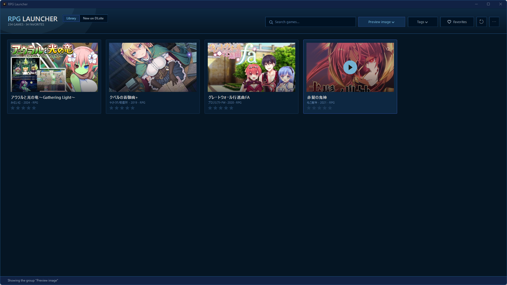

# RPG Launcher

A Windows and Linux launcher for RPG Maker, Wolf RPG Editor, Ren'Py, TyranoBuilder and Unity games that shows title screens as cards and fills in titles, tags and images from DLsite. 

...Or to be more honest, this is basically an HRPG launcher built around organizing DLsite games and checking new releases on the site more easily. The main feature of convenience is built-in network adapter + proxy settings to more easily check DLsite's page through a Japanese VPN without needing to constantly turn the VPN on or off. This launcher was completely vibecoded and while it works for me I really have no idea how any of the network stuff works, so go in with due caution and all that.



## Quick start

1. Download the launcher from the releases and put it in the holder with your games (or anywhere).
2. Run it. The first time, it asks what you're using it for (DLsite HRPGs or VIPRPGs) and opens in that mode. It scans its folder up to three levels deep. You can add other folders by going to the options menu (the ... menu) and choosing "Add Directory."
3. Click a game to play. Press `F5` to refresh the page after adding new games.

## Supported engines

| Engine | Detected by |
| --- | --- |
| RPG Maker MV / MZ | `www\data\System.json` or `data\System.json` |
| RPG Maker VX Ace / VX / XP | `Game.ini` with `Data\` or a `.rgss3a` / `.rgss2a` / `.rgssad` archive |
| RPG Maker 2000 / 2003 | `RPG_RT.exe` / `RPG_RT.ldb` |
| Wolf RPG Editor | `Game.exe` with `Data.wolf`, `Data\*.wolf`, `Data\BasicData` or `GuruguruSMF4.dll` |
| Ren'Py | `renpy\` and `game\` beside the game's exe |
| TyranoBuilder / TyranoScript | `tyrano\` and `data\`, loose or in `package.nw`, `resources\app.asar` or the exe itself |
| Unity | `Name.exe` beside `Name_Data\` |

Encrypted MV/MZ images and RGSS archives are read directly. Wolf games use the folder name as title until DLsite supplies one.

- **Ren'Py** titles come from `config.name` in the game's scripts, else from its `log.txt` (once it has been played) or its Mac app. The card picture is the main menu's background, found by following the scripts the way Ren'Py does (inside `.rpa` archives too), else the loading screen.
- **TyranoBuilder / TyranoScript** titles come from `data\system\Config.tjs`, and the card picture is the title scenario's background, read from inside the exe or package when the game is packed.
- **Unity** titles come from `Name_Data\app.info`. Unity games keep their pictures packed away, so their cards show the DLsite image, or else the game's own icon from its exe (Unity's default icon is skipped).
- A game shipped as 32- and 64-bit builds side by side (`Windows_32bit`, `Windows_64bit`) is listed once, as the 64-bit build.

## Features

- **Sort** by title, folder, rating, last or most played, release date or download date.
- **Filter** by engine, group, favorites, tags, or games without a DLsite page. **Search** covers titles, folder names, circles and tags in English and Japanese.
- **Ratings, favorites, play count and play time.**
- **Groups** — right-click a card → **Groups**. Groups appear in the sort menu; drag them there to reorder.
- **Tags** — click a tag once to show only games with it, twice to hide them, a third time to clear it. Right-click a tag to pin it. Right-click a card → **Add Tags…** for your own tags.
- **Names and pictures** — cards use the DLsite title and image, or the game's cleaned title and title screen. Right-click a card to rename it, change or reframe its picture, or choose title screen or DLsite image.
- **New on DLsite** — games released in the last 30 days, with price, discount, rating and tags.
- **Display** — four styles, rectangular or square cards, optional paging, English or Japanese metadata. On screens of 2560×1440 or more the window opens at 1920×1080.
- **Cheats** — right-click an MV or MZ game → **Play with Cheats** to change gold, levels, EXP, HP, MP and stats while playing, heal the party, walk faster or walk through walls. **Advanced…** edits variables, switches and items, runs and replays events, opens the save and load screens anywhere, and has a script console. Other RPG Maker games get **Play in Test Mode**. See [Cheats](#cheats).

| Key | Action |
| --- | --- |
| `F5` | Rescan (New on DLsite: refresh today) |
| `Ctrl+F` / `Esc` | Search / clear search |
| `Ctrl+PageUp` / `Ctrl+PageDown` | Previous / next page |

## DLsite

- Each game is looked up once, by the RJ code in its folder name or by searching its title. Japanese and English data are cached, so switching language needs no network. Only search terms and product codes are sent.
- A miss is remembered, not searched again on every launch. Right-click → **Look up metadata** retries; **Set DLsite page…** takes a link or RJ code.
- New on DLsite caches each day's releases for 30 days.
- Requests to DLsite pages are at least a second apart. If DLsite answers "too many requests", the launcher pauses and stops its queues.
- **⋯ → DLsite connection…** sends DLsite requests through a chosen network adapter (such as a VPN) or a SOCKS/HTTP proxy. If that route is unavailable, requests fail rather than go direct. **Test** shows which country DLsite sees. Proxy settings are saved encrypted (Windows DPAPI), readable only by your Windows account.

## Cheats

- **Play with Cheats** (MV, MZ) opens a cheat window beside the game. Values update live; a field you're editing is kept until you press **Apply**. Stats stop at the game's own caps. Faster walking (up to 4×) leaves cutscenes at their own pace; walking through walls also stops random battles, as in a playtest. Both last until the game closes. Other changes are in the running game, so save in the game to keep them.
- **Advanced…** in the cheat window opens a second window with these tabs:
  - **Variables** and **Switches** — every one the game has, by ID and name. Click a value to edit it (a whole number, text, or JSON such as `[1,2]`); click ON/OFF to flip a switch. The filter matches names or an exact ID.
  - **Items** — how many of each item, weapon and armor the party holds, up to the game's maximum.
  - **Events** — **Run** a common event or an event on the current map. **Replay** runs any page of a map event again, whatever its conditions. **Reset** turns its self switches off, so a one-time event can happen again. Events run on the map, once no other event is running; MZ games pause while their window isn't active, so click the game to see it.
  - **Saves** — opens the game's own save or load screen, even where the game has turned saving off, and can turn the menu's Save command back on.
  - **Console** — runs JavaScript in the game (Ctrl+Enter) and shows the result, like the game's developer console.
- To connect, the launcher appends a short script to the game's `js/plugins.js` and removes it as soon as the game has loaded it. The file is restored byte for byte, with its original date. The script only answers the launcher (a one-time token over a local port). A copy left behind by a crash stops working after 5 minutes and is removed the next time the game is played.
- **Play in Test Mode** (VX Ace, VX, XP, 2000/2003) starts the engine's own test play: hold Ctrl to walk through walls; F9 opens the switch and variable editor.
- Wolf RPG Editor, Ren'Py, TyranoBuilder and Unity games have no cheats.

## RPG Maker 2000 / 2003

**⋯ → RPG Maker 2000/2003** (or **設定** in VIPRPG mode) sets how these games start, after MoshimoLoader's launch options:

- **Runtime folder** — many games, VIPRPG ones especially, ship without `RPG_RT.exe`. Point this at a folder holding `2000\RPG_RT.exe` and `2003\RPG_RT.exe` (MoshimoLoader's `Data\Runtime` is found on its own when a game folder sits inside MoshimoLoader). The right runtime is copied into the game folder while it runs and removed afterwards.
- **Start in a window** — RPG_RT's `Window` argument; off starts full screen.
- **Small window** — presses F5 once the game is up, RPG_RT's switch to its 320×240 window.
- **One CPU core** — some games run too fast or freeze on several cores.
- **Memory stream error fix** — patches the cause of RPG_RT's "memory stream error" in the running game (Windows; the exe on disk is not changed).
- **EasyRPG Player** — [EasyRPG Player Kai](https://github.com/SomiaWhiteRing/EasyRPG-Player-Kai) 2026.11.1 (a modified [EasyRPG Player](https://easyrpg.org/) 0.8.1.1) comes with the launcher (`EasyRPG\Player.exe`, GPL v3; see `EasyRPG\README.txt`). By default it runs games that have no `RPG_RT.exe` and no runtime folder to borrow one from; **Use EasyRPG Player** runs every 2000/2003 game with it, and it can be turned off (VIPRPG mode: **設定 → EasyRPGを使う**). A game that ships its own `Player.exe` uses that. On Linux, an installed `easyrpg-player` runs natively, without Wine.

## VIPRPG mode

**⋯ → Mode: HRPG** switches to VIPRPG mode, and **設定 → モード** there switches back (the first start asks which one you want). It is a separate screen in the style of an RPG Maker 2000 game and the VIPRPG matsuri sites, with its own game folders and no DLsite at all.

- Every matsuri from 2005 on, with its works (about 4,300), listed **by matsuri** (祭り別) or **by author** (作者別). Each work links to its wiki page and its 感想スレ where they exist, and each matsuri to its site and its archived copy. Works on this PC are marked ▶ and start with Enter or a click; **手持ち** lists only those.
- Games are matched to works by entry number when their folders name the matsuri (`Kouhaku 2024\kouhaku2024_32`), otherwise by title. Games the wiki doesn't list are under **保管庫 → その他のゲーム**.
- Works show their title screen once they're on the PC; before that, a screenshot or cover from the matsuri's archived site on [fes.viprpg.org](https://fes.viprpg.org/), built into the launcher (about 2,100 works, at most 640×480).
- Works their matsuri page marks as never submitted (未提出, 辞退, a 0 MB download) show as エ (エターナル): no download of them exists.
- **Playlists** have their own list, プレイリスト. Right-click a game → プレイリスト to add it; ＋ テキストから作る… makes one from a text file of titles (one per line), keeping titles the launcher can't find in red as !!!!. Right-click a playlist → コードをコピー gives a code to share; ＋ コードから読み込む… adds one from a code. Codes carry matsuri works and archive games, not games only on your PC.
- Right-click a game → クリア済みにする marks it completed (（済）); 設定 → クリア済みの作品 hides completed games from every list. A matsuri's or playlist's page shows how many of its games are completed (クリア済み X/Y).
- Zipped games show as Z: **展開** unpacks one beside its zip (Shift-JIS names included) and rescans.
- **Downloads.** Works the [VIPRPG アップローダー保存庫](https://uploader.viprpg.org/) has archived are marked ↓; its index (about 10,000 files from the old matsuri and thread uploaders, stored on archive.org) is built into the launcher. **ダウンロード** (or Enter, or D) downloads one from archive.org, checks its size and checksum, unpacks it and rescans; pressing it again (中止) stops the download.
  - Games go in **設定 → ダウンロード先**, by default a `games` folder beside the launcher, as `<matsuri-id>\<No>.zip`, which is removed after unpacking. A download stays matched to its work whatever the zip's folder is called.
  - Archived games the catalog doesn't list, such as thread games, are in **保管庫** (Thread Storage), under the uploader they came from: the 7代目 保管庫, the wiki 作品保管庫 and dead-link re-uploads, the パー速 thread uploaders, モナーRPG, アレックス総受け and others. A matsuri's own uploaders add nothing there (what's left in them is patches and re-uploads), and uploaders with only one or two games are left out.
  - Clicking a selected work that isn't on the PC downloads it.
  - `.rar`, `.7z`, `.lzh` and `.exe` downloads are saved and shown in their folder, to unpack or run yourself; press F5 after.
  - Files the archive listed but didn't keep (mostly password-protected uploads) download from getuploader itself, which closes on 25 November 2026; the launcher asks for an upload's password, which the matsuri page or thread usually gives.
  - Works the archive doesn't have yet (such as recent matsuri on itch.io) download from the link the matsuri listed, when it's a free itch.io game, a getuploader upload, a Google Drive file or a Wayback Machine copy. **配布元** opens the original link for any work, including ones on MEGA, Yahoo and other sites the launcher can't download from.
- **テスト** starts test play.
- **設定 → 言語** shows the launcher in Japanese or English (祭り → festival, 保管庫 → Thread Storage). Titles, authors and matsuri names stay as they are.
- The left half goes a page at a time: the list type (手持ち, 全作品, 祭り別, 作者別, 保管庫, プレイリスト), then a matsuri, author, uploader or filter, then its works; ◀, Esc or a right-click on empty space goes back. The right half shows the selected work. 再スキャン, フォルダ追加 and 設定 are at the top right.
- Keys: arrows move, Enter/Z or → goes in, Esc/X or ← goes back, Ctrl+F searches, F5 rescans, D downloads, S opens 設定. Mouse and wheel work too.
- The windows come from the RPG Maker 2000 RTP installed on the PC (the one VIPRPG games need), read when the launcher runs; none of it is included in the launcher. Without an RTP they are drawn plainly.
- To use another system graphic, put it in a `vip-sozai` folder beside the launcher as `system.png`.
- Work lists come from [VIPRPG全祭り補完サイト](https://fes.viprpg.org/) and the [VIPRPG wiki](https://w.atwiki.jp/vip_rpg/pages/502.html), built into the launcher.

## Linux

- The launcher is a native Linux program. Unpack the `.tar.gz` (it keeps the file executable) and run `RPG Launcher`; it needs X11 or XWayland and the ICU library (`libicu`), which desktop distributions include.
- Windows games start through Wine (`wine` on the path). Ren'Py games that include a Linux build start natively with their own `Name.sh` (when that build is marked executable), as do Linux builds of Unity games. **⋯ → Wine command…** sets another, such as `flatpak run org.winehq.Wine`. Games get a Japanese locale (`LANG=ja_JP.UTF-8`) so their text shows; `env LANG=… wine` overrides it.
- Cheats and test mode work the same through Wine.
- Proxy settings are encrypted with a key only your user can read, in `~/.config/rpg-launcher`.
- Sending DLsite requests through a network adapter needs Linux 5.7 or newer.

## Data

Stored next to the exe:

| Path | Contents |
| --- | --- |
| `launcher-data.json` | Ratings, groups, tags, play time, metadata, settings |
| `launcher-library.json`, `launcher-thumbnails\` | Scan cache (safe to delete) |
| `launcher-images\` | Custom and DLsite card images |
| `launcher-dlsite\` | New-release cache |
| `launcher-vip-library.json`, `launcher-vip-server.json` | VIPRPG mode's scan cache and download list (safe to delete) |

Delete them all to reset. If `launcher-data.json` can't be read, a copy is kept as `launcher-data.json.broken`.

## Building

Requires the [.NET 8 SDK](https://dotnet.microsoft.com/download/dotnet/8.0). The interface uses [Avalonia](https://avaloniaui.net/).

```powershell
.\build.ps1                       # Windows: self-contained single-file exe
.\build.ps1 -Runtime linux-x64    # Linux: single file in LauncherSource\bin\publish\linux-x64
.\build.ps1 -FrameworkDependent   # smaller; needs the .NET 8 runtime
.\build.ps1 -NoCompression        # larger, faster startup
```

Without PowerShell: `dotnet publish LauncherSource/RPGLauncher.csproj -c Release -r linux-x64 --self-contained -p:PublishSingleFile=true -p:IncludeNativeLibrariesForSelfExtract=true`.

## Troubleshooting

- **SmartScreen warning** — the exe is unsigned: **More info → Run anyway**.
- **Game missing** — check the engine table and folder depth, then press `F5`.
- **No metadata** — sort menu → **No DLsite Page** lists these games; use **Set DLsite page…**.
- **Linux: a game doesn't start** — check that `wine` runs it from a terminal, or set **⋯ → Wine command…**.
- **Crash** — see `%TEMP%\rpglauncher.log` (Linux: `/tmp/rpglauncher.log`).
